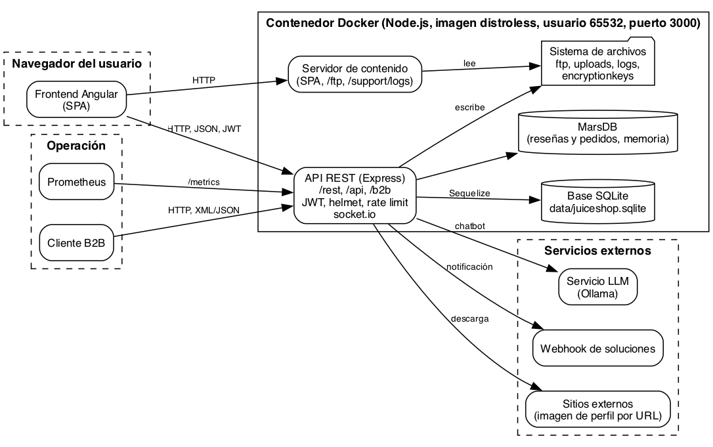

# Arquitectura de OWASP Juice Shop

Juice Shop es una tienda web hecha con Node.js, TypeScript y Angular. Se ejecuta como un solo contenedor Docker que expone el puerto 3000 y no necesita servicios externos para funcionar.

## Componentes

| Componente | Tecnología | Qué hace |
|---|---|---|
| Frontend | Angular | Aplicación de una sola página que se ejecuta en el navegador y llama a la API |
| Servidor de contenido | Express | Sirve la SPA y los directorios `/ftp` y `/support/logs` |
| API REST | Express, JWT, helmet, express-rate-limit | Rutas `/rest`, `/api` y `/b2b`, autenticación, subida de archivos, chatbot y WebSocket con socket.io |
| Base SQLite | Sequelize | Usuarios, cestas, tarjetas, direcciones, quejas y comentarios en `data/juiceshop.sqlite` |
| MarsDB | MarsDB | Reseñas de productos y pedidos, en memoria |
| Sistema de archivos | Disco del contenedor | Directorios `ftp`, `uploads`, `logs` y `encryptionkeys` |

## Servicios externos

| Servicio | Para qué se usa |
|---|---|
| Servicio LLM, por defecto Ollama | El chatbot le envía las preguntas de los usuarios |
| Webhook de soluciones | Recibe un aviso cuando se resuelve un reto, solo si se define `SOLUTIONS_WEBHOOK` |
| Sitios externos | La API descarga la imagen de perfil desde la URL que indica el usuario |
| Prometheus | Lee las métricas de `/metrics` |

## Despliegue

- La imagen se construye con el `Dockerfile` del repositorio. La etapa de construcción usa `node:24` y la imagen final es `distroless/nodejs24` con el usuario 65532, sin privilegios.
- La aplicación escucha en HTTP, sin TLS. Para este proyecto corre solo en contenedores propios, local o dentro del pipeline.
- Cada contenedor arranca con la base SQLite y los datos de ejemplo que genera `data/datacreator.ts`.
- El pipeline de GitHub Actions construye la imagen en cada pull request y la usa como objetivo de los escaneos.
